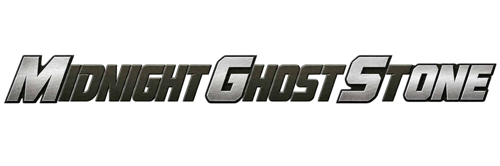

<p align="center">
  
</p>

# Midnight Ghost Stone

A native PC recompilation of *Metal Gear Solid* for PlayStation, with a modern
Vulkan presentation built around the original game assets. Repository:
**mgsone-recomp**.

## Credit Where It Belongs

Before the shaders, bubbles and increasingly elaborate surveillance cameras:
**this project builds on a tremendous amount of work by other people**.

- **[FoxdieTeam / mgs_reversing](https://github.com/FoxdieTeam/mgs_reversing)**
  provides the decompilation research behind our understanding of the game,
  its actors, scripts and graphics. The imported texture module is attributed
  separately in the source and notices.
- **[PS1Recomp](https://github.com/Dellareti/ps1-recomp)** is the engine
  foundation, inherited through the local Crash Bandicoot 3 recompilation.
  **[SwanStation](https://github.com/libretro/swanstation)** is our instrumented
  donor and reference for checking original behavior.
- **[Rex](https://github.com/Jayveer/Rex)**,
  **[MGS-KMD-Noesis](https://github.com/Jayveer/MGS-KMD-Noesis)** and
  **[mint](https://github.com/virusek20/mint)** helped make the original formats
  understandable. **[PSXRecomp](https://github.com/RetroPortingToolKit/psxrecomp)**,
  **[RecompOne](https://github.com/BlackLabelHQ/RecompOne)** and
  **[Alexbeav's MGS recomp](https://github.com/Alexbeav/metal-gear-solid-recomp)**
  are additional research references, with reuse recorded in the documentation.
- **Godot / Intel ASSAO, N8AO, SDL, Dear ImGui** and the controller-mapping
  community supply important rendering and interface foundations.

And, of course, **Konami and the original Metal Gear Solid team**, who made
the game worth doing all this for.
[Credits, provenance and license scope](packaging/THIRD_PARTY_NOTICES.md).

> **Experimental alpha source, not a certified complete port.**
> Linux and Windows candidates exist, but this publication does not include
> a ready-to-play binary release. A continuous completed campaign, every boss
> fight and physical Steam Deck compatibility have not been certified.

## About

Midnight Ghost Stone follows the same general idea as the modern recomp
projects: let the game run natively, then give its presentation room to breathe.
I wanted to play Metal Gear Solid again. Naturally, this turned into a project
about water refraction, Codec screens and whether a cardboard box needs
ambient occlusion.

The visual goal is **a modern rendering of the original image**, with its
atmosphere and visual identity intact. Vulkan can use original meshes,
floating-point animation, per-pixel lighting and modern effects without
recreating the PlayStation's drawing method. Underneath, gameplay keeps its
original timing and behavior. Changes to the presentation are documented so
that a nicer-looking effect cannot quietly become an unexplained regression.

Most game logic currently uses **static MIPS-to-native recompilation**.
Selected decompiled C routines replace it where they have been adapted and
checked against the USA executable. This is an ongoing migration, not a claim
that the entire game has already been rewritten in clean C.

**Development of this project is entirely AI-assisted, under human direction.**
That describes the project-specific work, not the mature donor projects and
libraries above. As with [TriAevum](https://github.com/coccofresco/TriAevum),
there is a fair amount of concentrated AI slop here. The regression tests are
an attempt to make it accountable.

## Install and build

The current game target is **USA v1.0**, both discs:
**SLUS-00594** and **SLUS-00776**. You need your own original BIN images or
single-track MODE2/2352 CUE/BIN pairs. Other regions, Integral and modified
images are not currently supported by the native game build. No BIOS download
is required. Discs, extracted assets and generated game translations are
prepared locally and are excluded from this repository.

### Linux development build

Requires Python 3.11+, CMake 3.20+, Ninja, a C++20 compiler, SDL 2.26+, Vulkan
development files, `glslc`, and a working Vulkan GPU driver. On Ubuntu 24.04,
the build packages are:

```sh
sudo apt-get install git cmake ninja-build g++ libsdl2-dev libvulkan-dev glslc python3
git clone https://github.com/coccofresco/mgsone-recomp.git
cd mgsone-recomp
bash scripts/build_alpha.sh '/path/to/disc1.cue' '/path/to/disc2.cue'
python3 scripts/mgs_alpha.py --user-dir "$PWD/data/alpha-build"
```

This verifies and imports both discs, generates the native game code, builds
the runtime and runs its tests. The last command opens the launcher using
that same imported profile. Compilation of the generated game code can take
time and substantial memory; `BUILD_JOBS=2` reduces build parallelism.

The dependencies under `engine/third_party` are included; no local donor
checkout or recursive submodule clone is needed for this build.

### Windows, SteamOS and portable packages

Windows x64 uses the same game and renderer sources. The current build path
cross-compiles from Linux using pinned dependencies; see
[Windows build and validation](docs/mgs-windows.md).
The existing Windows validation ran the real PE executables through Wine on
a physical Vulkan GPU. Testing on native Windows hardware remains necessary.

Linux packaging targets **AppImage and Flatpak**, with a controller-navigable
launcher for desktop use and Steam Big Picture. Steam Input uses the standard
Gamepad layout. Physical Deck, controller transport and suspend/resume testing
remain on the acceptance list. See
[installation and settings](docs/mgs-alpha-install.md),
[SteamOS packaging](docs/mgs-steamos.md) and
[controller compatibility](docs/mgs-controllers.md).
These pages describe development candidates, not downloadable public releases.

Keep ordinary **in-game Codec saves** as well as quick states. Alpha savestate
compatibility can change between builds. The launcher separates application
files from user data and provides explicit save backups and diagnostic exports.

## Graphics and controls

- Original **KMD/ZMD meshes, PCX textures and animated poses** feed the Vulkan
  presentation, with a resident asset cache prepared from both discs.
- **True 4K output** by default, selectable lower resolutions and fixed **16:9**
  framing that does not stretch with the window.
- Floating-point geometry and articulated poses, per-pixel lighting and modern
  color precision. Original low-resolution rendering remains a separate
  reference for development checks.
- Ambient occlusion adapted from **Godot / Intel ASSAO**, with a
  distance-dependent radius informed by **N8AO**.
- Modern water, depth fog, bubbles, particles, screen effects and temporal
  trails. Surveillance and Codec effects reconstruct a simulated **CRT / RGB
  phosphor image**, keeping subtitles readable outside the effect.
- Experimental **60 FPS presentation interpolation** between original game
  states. The game retains its original 30/20 Hz logic; this does not turn
  gameplay into 60 Hz physics. Currently opt-in through the developer runtime
  (`PS1_MGS_FRAME_INTERPOLATION=1` with `scripts/run_native.sh`), not a launcher
  setting. [Implementation and measured evidence](docs/mgs-frame-interpolation-evidence.json).
- Fast loading, **automatic disc 1 → disc 2 change**, persistent memory cards,
  quick-state slots, a host pause menu and controller-port switching.
- Keyboard and SDL controllers, Steam Input integration, device selection,
  deadzone settings and an input test screen.

The original textures are still the original textures. Rendering them at 4K
does not invent detail they never contained. Effects and resolution also cost
GPU time; choose settings that suit your hardware.

| Action | Default control |
| --- | --- |
| Move | Arrow keys / D-pad / left stick |
| Cross / Circle / Square / Triangle | Z / X / A / S |
| L1 / R1 / L2 / R2 | Q / W / E / R |
| Start / Select | Enter / Backspace |
| Host pause menu | Esc / right-stick click (R3) |
| Save / load quick state | F5 / F9 |
| Previous / next state slot | F6 / F7 |
| Toggle fullscreen | F11 |

## Testing and contributing

The useful question is not just whether the intro looks nice, although I have
spent an unreasonable amount of time on that. It is whether the game behaves
correctly when a door opens, a cutscene finishes, a card is saved or the second
disc takes over.

Checks cover independent scenarios on **both discs**, mandatory transitions,
death and Continue, torture branches, PAL terminals, prepared REX/Liquid phase
exits, both endings, credits and the final save. Native behavior is compared
with the instrumented donor. Some tests deliberately prepare a particular
state: they prove that transition, not the entire fight leading up to it.
Actual Vulkan GPU checks are recorded separately from headless runtime tests.

Full fights, jeep combat and a continuous start-to-finish playthrough still
need work. People willing to play, investigate and report reproducible
problems are especially welcome. See the
[gameplay coverage and open cases](docs/mgs-completion.md),
[mandatory-path checks](docs/mgs-required-paths.md) and
[original-asset GPU validation](docs/mgs-asset-presentation-validation.md).

Please [report issues](https://github.com/coccofresco/mgsone-recomp/issues)
with the commit/build, OS, GPU and driver, selected settings, disc, difficulty,
location and exact steps to reproduce. Mention whether the session came from
an in-game save or a quick state. Screenshots and inspected diagnostic exports
help. Do not attach discs, extracted assets or full memory savestates to public
issues. Contributions and forks are welcome; include a reproducible check for
the behavior being changed.

Public CI builds the launcher, shaders and source-only tests without game
data. That checks the published source; it is not a substitute for the private
retail-input or physical-GPU validation. Developer details are in the
[runtime progress log](docs/mgs-runtime-progress.md) and
[presentation contract](docs/mgs-vulkan-presentation.md).

## Source and license

The engine uses **GPL-3.0**; see [LICENSE](LICENSE). Third-party code retains
its own notices and terms. The attributed FoxdieTeam texture adaptation is
documented separately; the engine license does not assign a new license to
that upstream work. See the [full notices](packaging/THIRD_PARTY_NOTICES.md)
and [engine provenance](docs/engine-provenance.json).

This is an independent, unofficial project, not affiliated with or endorsed
by Konami. Metal Gear Solid and its assets belong to their respective owners.

At least the cardboard box has somewhere modern to hide.
