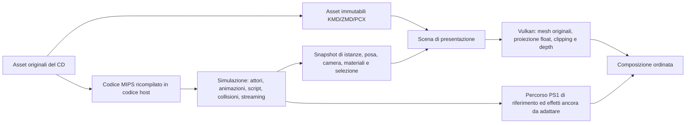

# Contratto per la presentazione Vulkan di MGS

**Cache originale residente in Vulkan, cattura della scena USA e prima
sostituzione selettiva della geometria implementate.** Il percorso sperimentale è
descritto in [mgs-original-mesh-replay.md](mgs-original-mesh-replay.md). Il runtime USA raggiunge
il gameplay del molo. I formati e le prove iniziali su disco sono in
[mgs-3d-formats.md](mgs-3d-formats.md). La prima integrazione concreta, i comandi
e i limiti verificati sono in [mgs-vulkan-cache.md](mgs-vulkan-cache.md).
Il contratto seguente descrive anche le parti ancora da realizzare.

## Criterio di fedeltà e regressioni

La fedeltà richiesta è nella resa generale dell'immagine: composizione,
leggibilità, atmosfera, intensità relativa degli effetti e loro relazione
spaziale con la scena. La presentazione moderna deve superare i limiti PSX:
risoluzione, precisione cromatica e geometrica, illuminazione e costruzione degli
effetti. Si preferiscono metodi nativi Vulkan che migliorino resa e prestazioni;
la sequenza dei primitive, il rendering per scanline, il dithering e gli altri
espedienti hardware originali non sono obiettivi da riprodurre.

Per ciascuna sostituzione documentare il significato dell'effetto nel gioco,
i dati originali usati, il metodo Vulkan scelto e il motivo della scelta.
Conservare confronti visivi su scene e istanti identificabili, parametri e hash
della build, misura dei costi alla risoluzione di presentazione e modalità di
confronto col riferimento. Le differenze intenzionali vanno distinte dalle
regressioni; un confronto pixel per pixel non misura da solo la fedeltà visiva.
Le verifiche di script, audio, streaming e salvataggi certificano separatamente
il comportamento sottostante e non vincolano il renderer ai metodi PSX.

L'[occlusione ambientale da Godot 4.7.2](mgs-ambient-occlusion.md) applica
questo criterio: calcolo e filtro Vulkan sulla profondità moderna, senza
modificare VRAM o simulazione. La documentazione distingue le parti adattate
da ASSAO, la composizione sul colore finale, i limiti e le catture A/B.

## Separazione delle responsabilità



Non c'è una freccia di ritorno da Vulkan alla simulazione. Collisioni, AI,
telecamera logica, gameplay, OAR, streaming, cambio CD e temporizzazione sono
eseguiti dal codice ricompilato. Il renderer legge snapshot posseduti dal lato
host; nessun puntatore host viene scritto in RAM guest. Screenshot, depth
ricostruita, interpolazione e visibilità ampliata non modificano lo stato del gioco.

Questo è il principio già seguito dal presenter di Crash in
[`crash3_object_presenter.h`](../engine/ps1Runtime/include/runtime/games/crash3_object_presenter.h)
e dalle catture residenti di
[`crash3_profile.h`](../engine/ps1Runtime/include/runtime/games/crash3_profile.h).
Si riutilizzano gestione Vulkan, upload, risorse residenti, snapshot, diagnostica
e infrastruttura di composizione. Decoder, selettori, indirizzi e assunzioni di
Crash restano specifici di Crash: MGS avrà il proprio adattatore.

## Dati da conservare

| Record host proposto | Identità e contenuto minimo |
|---|---|
| Asset | SHA-256 originale, disco/scenario/offset, cache ID, tipo, generazione di caricamento; KMD/ZMD non rilocato |
| Mesh | indici del modello e della faccia, quattro corner originali, stream separati posizione/normale/UV, parent, extend e seam |
| Istanza | ID con generazione di allocazione, asset associato, root, gruppo/canale, flag semantici, attachment, stato attivo |
| Posa | tick nativo, rots/movs/adjust/waist, world per oggetto o operandi necessari alla composizione; eventuali deformazioni locali |
| Camera | camera logica, matrice view, distanza di proiezione, viewport, overscan e composizione; versione dello snapshot |
| Materiale | texture ID risolto, asset e generazione, palette corrente, UV/domain, ABR/STP, flag di modello, override ed effetti |
| Illuminazione | luci ambientali/direzionali/locali, preshade e parametri selezionati dal codice del titolo |
| Provenienza draw | istanza/modello/faccia/corner e legame con i pacchetti originali, quando sostituiti |

Un hash a 16 bit non basta come chiave mesh/materiale. Nemmeno l'indirizzo RAM è
stabile: lo stesso spazio ospita risorse diverse dopo caricamenti e cambio stage.
L'inventario offline permette di ritrovare i byte; il lifetime runtime certifica
quale istanza li sta effettivamente usando. Palette e texture possono cambiare
senza che cambi la geometria: mantenere generazioni separate.

## Confini di cattura candidati

I nomi sorgente provengono dal reversing di Integral. Per USA v1.0 è verificato
`DG_BoundChanl` a `0x8001919C`: il recipe controlla il fingerprint dell'eseguibile
e della prima istruzione e cattura prima del culling. Gli altri hook candidati
richiedono ancora confronto di istruzioni/strutture e tracce USA; non si riusano
gli indirizzi numerici di Integral o della versione italiana.

1. `GV_LoadInit`, `DG_LoadInitKmd`, `DG_LoadInitKmdar`: riconoscere e copiare
   l'asset prima della rilocazione e della riscrittura dei seam. Associare il
   risultato alla cache, inclusi i KMD registrati da uno ZMD.
2. `DG_MakeObjs`, `DG_FreeObjs`, `DG_QueueObjs`, `DG_DequeueObjs`: generazioni e
   lifecycle delle istanze. Tracciare anche la selezione di mappa e le modifiche
   dei flag di visibilità; non assumere che ogni KMD su disco sia visibile.
3. `DG_ScreenChanl` e `DG_ApplyRots`/`DG_ApplyMovs`: acquisire la posa/camera e
   gli operandi di composizione. La pipeline sorgente procede poi con
   `Bound → Trans → Shade → Prim → Divide → Sort`.
4. Catturare la lista semanticamente ammessa **prima dei test geometrici** di
   `DG_BoundChanl`/`DG_TransChanl`. Una faccia già scartata dal vecchio frustum o
   dal clipping PS1 non può essere recuperata da un semplice replay GP0.
5. `DG_SetTexture`, cache residenti e modifiche a CLUT/pacchetti: risolvere i
   materiali effettivi. `DG_WriteObjPacketUV/RGB` e i percorsi di shading sono
   punti di confronto, non l'unica sorgente della nuova geometria.
6. Chiusura snapshot coerente per tick/frame, invalidazione su stage unload,
   realloc, reset e cambio CD. Il renderer non legge memoria guest in corsa.

Fonti: [cache](https://github.com/FoxdieTeam/mgs_reversing/blob/master/source/libgv/cache.c),
[oggetti](https://github.com/FoxdieTeam/mgs_reversing/blob/master/source/libdg/obj.c),
[ordine pipeline](https://github.com/FoxdieTeam/mgs_reversing/blob/master/source/libdg/chanl.c),
[posa](https://github.com/FoxdieTeam/mgs_reversing/blob/master/source/libdg/screen.c),
[strutture runtime](https://github.com/FoxdieTeam/mgs_reversing/blob/master/source/libdg/libdg.h).

## Precisione e animazione

La prima baseline può trasformare i vertici sorgente mediante le matrici world
native catturate, usando float per view, proiezione e clipping. Questo elimina
le perdite della proiezione a coordinate schermo intere e l'interpolazione UV
affine, ma **non recupera** la precisione già persa nella composizione fixed-point
delle matrici. Non chiamarla ancora eliminazione completa dei limiti PS1.

Il passo successivo ricompone in float la gerarchia dagli operandi sorgente:
root, joint, traslazioni, adjust e waist, nell'ordine verificato del titolo.
L'interpolazione tra due tick deve usare la stessa istanza/generazione, rispettare
teletrasporti, tagli di camera, cambio animazione e joint parentali. Non estrapolare
una scena dopo unload. Il tick nativo si misura nel runtime; non si eredita il 30 fps
fisso del plugin Noesis. La quantizzazione già presente nell'asset rimane originale.

I seam di KMD richiedono il vertice **del parent trasformato**, non una normale
pesatura a due ossa né una ricerca per prossimità. `extend` non è un nuovo root.
Modifiche di geometria da parte degli attori, environment mapping, mantelli o
altri effetti devono avere un percorso esplicito; uno snapshot statico non basta.

## Rasterizzazione e composizione

- Opaque: vertici originali, trasformazioni float, depth comune, UV prospettiche,
  clipping moderno e risoluzione libera. Verificare assi, winding, diagonale dei
  quad, unità, Z e near plane con pose note prima di ampliare il frustum.
- Semitrasparenza: conservare la classificazione STP/ABR e l'ordine necessario.
  Un ordinamento automatico per centroide o il solo depth buffer può rompere
  intersezioni, ombre ed effetti voluti. Separare i casi verificati.
- HUD, codec, filmati e `DG_PRIM`: percorsi dedicati o composizione ancora basata
  sul runtime PS1, finché non è disponibile un equivalente semantico verificato.
- Feedback/maschere: mantenere le dipendenze di lettura/scrittura delle immagini
  e la semantica usata dal gioco. Il percorso moderno non può restituire alla
  simulazione dati diversi perché produce un framebuffer più grande.
- Sostituire ogni draw certificato una sola volta. La provenienza della faccia
  deve consentire di sopprimere il corrispondente contributo originale senza
  cancellare effetti sovrapposti né disegnare due volte la stessa mesh.

Il widescreen estende il frustum di presentazione per la geometria caricata e
semanticamente ammessa. Non forza caricamenti, attori o aree che lo script ha
escluso. Il formato del modello da solo non decide la visibilità narrativa.

## Verifiche necessarie per integrare il primo scenario

1. **Asset:** range, indici, parent/seam, extend, UV, associazioni texture e ZMD;
   confrontare le estrazioni con uno strumento indipendente. Questo lavoro ha
   una prima evidenza offline, dettagliata nel documento sui formati.
2. **Agganci USA:** completare loader e pipeline nel main interno, poi
   verificare lifetime di cache/oggetti e gli overlay usati dallo scenario scelto.
3. **Geometria e posa:** confronto di punti modello/world/view e giunzioni su
   pose ferme e animate; esplicitare la tolleranza solo dove si introduce float.
4. **Materiali:** texture selezionata, dimensioni, UV, palette, STP/ABR, luci,
   override, primitive procedurali e passaggi di composizione.
5. **Invarianza della simulazione:** stessa sequenza input, stato CPU/RAM e
   eventi/tick con presentazione originale e moderna; nessun risultato GPU
   moderno influenza il gioco. Includere caricamenti, save/load e cambio CD.
6. **Completezza visiva:** ambiente e personaggi, seam, trasparenza, effetti,
   codec, filmati, camera e transizioni; near-plane e widescreen come prove
   specifiche, non dedotte dall'esito di un visualizzatore offline.

La scena del molo è ora sostituita mediante il [bridge dalla cache](mgs-original-mesh-replay.md),
con materiali, deformazioni, suddivisione e quad procedurali. Il ripristino da
savestate ricostruisce le associazioni. Restano da verificare altre scene e da
implementare culling indipendente, famiglie LOD e interpolazione.


## Registrazione a 60 fps e interpolazione MGS (10 ottobre 2026)

`PS1_MGS_FRAME_INTERPOLATION=1` attiva ora un percorso MGS autonomo. Il
percorso temporale ereditato da Crash 3 non era collegato alle mesh MGS: il
solo output video a 60 fps non avrebbe aggiunto pose intermedie.

La presentazione correla le facce originali KMD tramite epoca della scena,
continuità osservata dell'istanza DG, asset, modello e faccia. Interpola le
matrici per vertice, le normali, le posizioni per l'illuminazione e la luce
ambiente/direzionale in uniform buffer separati. Vulkan continua a leggere i
vertici originali dalla cache e rasterizza nuovamente geometria, profondità,
materiali, illuminazione per pixel ed effetti. Non viene usata interpolazione
ottica del filmato né fusione delle immagini già renderizzate.

Una coppia a 30 Hz produce la fase 1/2; una coppia a 20 Hz produce 1/3 e 2/3.
L'atlas di compatibilità viene salvato, usato per le fasi di presentazione e
ripristinato prima di applicare una sola volta l'endpoint originale. Le fasi
risolte, AO incluso, sono conservate in immagini Vulkan e presentate ai
VBlank successivi. La latenza aggiunta è di uno o due VBlank. Il guest non
riceve tick aggiuntivi né scritture dei dati interpolati.

Identità duplicate, istanze nuove, materiali incompatibili e facce senza
corrispondenza mantengono l'endpoint. Epoche diverse, intervalli diversi da
2/3 VBlank, teletrasporti e cambi bruschi della camera interrompono la coppia.
Le soglie conservative sono nel modulo `mgs_frame_interpolation.cpp`, non
sono selettori di scene: 20 gradi circa per asse della camera, 2000 unità per
la traslazione della camera e 1000 per gli spostamenti dei vertici illuminati.
I reset/reanchor e il ridimensionamento del target eliminano le fasi pendenti.
Il Codec resta animazione 2D originale, composta con il CRT moderno: i suoi
ritratti/testi non sono mesh alle quali inventare pose geometriche. Anche le
primitive procedurali prive di identità originale conservano la loro cadenza.

Il registratore acquisisce direttamente lo scanout Vulkan completo in una
pipe RGBA verso NVENC, ora con `--fps 60` predefinito (`--fps 30` disabilita
l'interpolazione). `video-timeline.csv` registra VBlank e tipo di ogni frame;
il controllo comune rifiuta buchi, duplicazioni temporali, conteggi incoerenti,
assenza di interpolazione nelle riprese 3D, errori di risorse o di validazione.
`--content codec` richiede invece l'effettiva esecuzione del pass Codec su GPU.
Il montatore verifica gli hash delle prove e impone la stessa frequenza per
tutte le riprese: non converte filmati a 30 fps in una consegna dichiarata 60.
La velocità di registrazione con readback UHD e validation layer non è una
misura delle prestazioni del gioco in tempo reale.

Le registrazioni precedenti a 30 fps rimangono in
`data/media/promo-20261010-corrected`; le nuove riprese e le verifiche sono in
`data/media/promo-20261010-60fps` e `data/validation/interpolation-20261010`.


Il promo aggiornato contiene 5400 frame a 60/1 fps (90 secondi), inclusi 2243
frame geometrici intermedi e otto secondi di Codec a 00:35.767–00:43.767.
Entrambi gli export sono stati decodificati integralmente e i timestamp di
tutti i pacchetti verificati: passi esatti di 1/60, senza buchi o duplicati.
La coda audio è sotto -140 dBFS e il frame finale è nero entro il residuo di
quantizzazione H.264 (massimo RGB 4/255 su pochissimi pixel). Le prove e gli
hash sono in [mgs-frame-interpolation-evidence.json](mgs-frame-interpolation-evidence.json).

Il controllo TAS registra senza interpolazione e riproduce con interpolazione
fino allo stesso checkpoint sicuro. Nei 180 VBlank dell'esempio, CPU/GTE,
2 MiB di RAM, scratchpad e tutti i 1048576 byte della VRAM originale (bit
maschera inclusi) coincidono; la seconda esecuzione presenta 88 intermedi.
Sono passati 78 test C++ selezionati, inclusi quelli Vulkan su GPU fisica;
205 test Python passano e 5 opzionali restano saltati. La generazione 20 Hz è
coperta dai test unitari; queste riprese usano geometria a 30 Hz.

La prova può essere ripetuta su qualsiasi checkpoint 3D con:

```sh
python scripts/mgs_interpolation_check.py --state percorso/checkpoint.ps1s \
  --output data/validation/interpolation-nuova-scena --frames 180
```

Non confrontare i dump eseguiti allo shutdown libero come se fossero allo
stesso punto di esecuzione: il thread guest può trovarsi a un diverso confine
istruzione. La prova TAS usa invece lo stesso rendezvous. I file completi
`.ps1s` dell'esempio differiscono solo per tre byte di padding della struttura
`PadModuleSnapshot` e il relativo checksum; questo padding non è uno stato
guest e non entra nel confronto CPU/RAM/VRAM.
