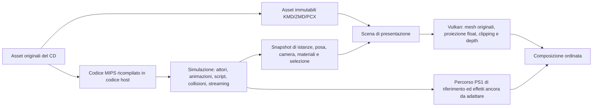

# Contratto per la presentazione Vulkan di MGS

**Proposta di architettura, non integrazione già attiva.** I formati e le prove
su disco sono in [mgs-3d-formats.md](mgs-3d-formats.md). Non esiste ancora un boot
MGS validato nel runtime; gli agganci PAL ITA indicati sotto vanno identificati.

## Separazione delle responsabilità

Non c'è una freccia di ritorno da Vulkan alla simulazione. Collisioni, AI,
telecamera logica, gameplay, OAR, streaming, cambio CD e temporizzazione sono
eseguiti dal codice ricompilato. Il renderer legge snapshot posseduti dal lato
host; nessun puntatore host viene scritto in RAM guest. Screenshot, depth
ricostruita, interpolazione e visibilità ampliata non modificano lo stato del gioco.

Questo è il principio già seguito dal presenter di Crash in
[`crash3_object_presenter.h`](../engine/ps1Runtime/include/runtime/games/crash3_object_presenter.h)
e dalle catture residenti di
[`crash3_profile.h`](../engine/ps1Runtime/include/runtime/games/crash3_profile.h).
Si riutilizzano gestione Vulkan, upload, risorse residenti, snapshot, diagnostica
e infrastruttura di composizione. Decoder, selettori, indirizzi e assunzioni di
Crash restano specifici di Crash: MGS avrà il proprio adattatore.

## Dati da conservare

| Record host proposto | Identità e contenuto minimo |
|---|---|
| Asset | SHA-256 originale, disco/scenario/offset, cache ID, tipo, generazione di caricamento; KMD/ZMD non rilocato |
| Mesh | indici del modello e della faccia, quattro corner originali, stream separati posizione/normale/UV, parent, extend e seam |
| Istanza | ID con generazione di allocazione, asset associato, root, gruppo/canale, flag semantici, attachment, stato attivo |
| Posa | tick nativo, rots/movs/adjust/waist, world per oggetto o operandi necessari alla composizione; eventuali deformazioni locali |
| Camera | camera logica, matrice view, distanza di proiezione, viewport, overscan e composizione; versione dello snapshot |
| Materiale | texture ID risolto, asset e generazione, palette corrente, UV/domain, ABR/STP, flag di modello, override ed effetti |
| Illuminazione | luci ambientali/direzionali/locali, preshade e parametri selezionati dal codice del titolo |
| Provenienza draw | istanza/modello/faccia/corner e legame con i pacchetti originali, quando sostituiti |

Un hash a 16 bit non basta come chiave mesh/materiale. Nemmeno l'indirizzo RAM è
stabile: lo stesso spazio ospita risorse diverse dopo caricamenti e cambio stage.
L'inventario offline permette di ritrovare i byte; il lifetime runtime certifica
quale istanza li sta effettivamente usando. Palette e texture possono cambiare
senza che cambi la geometria: mantenere generazioni separate.

## Confini di cattura candidati

I nomi qui sotto provengono da Integral; **nessun indirizzo numerico è ancora
certificato per `MGS1.EXE` italiano**. Prima di installare hook servono confronto
di istruzioni/strutture e tracce effettive dell'eseguibile italiano e degli overlay.

1. `GV_LoadInit`, `DG_LoadInitKmd`, `DG_LoadInitKmdar`: riconoscere e copiare
   l'asset prima della rilocazione e della riscrittura dei seam. Associare il
   risultato alla cache, inclusi i KMD registrati da uno ZMD.
2. `DG_MakeObjs`, `DG_FreeObjs`, `DG_QueueObjs`, `DG_DequeueObjs`: generazioni e
   lifecycle delle istanze. Tracciare anche la selezione di mappa e le modifiche
   dei flag di visibilità; non assumere che ogni KMD su disco sia visibile.
3. `DG_ScreenChanl` e `DG_ApplyRots`/`DG_ApplyMovs`: acquisire la posa/camera e
   gli operandi di composizione. La pipeline sorgente procede poi con
   `Bound → Trans → Shade → Prim → Divide → Sort`.
4. Catturare la lista semanticamente ammessa **prima dei test geometrici** di
   `DG_BoundChanl`/`DG_TransChanl`. Una faccia già scartata dal vecchio frustum o
   dal clipping PS1 non può essere recuperata da un semplice replay GP0.
5. `DG_SetTexture`, cache residenti e modifiche a CLUT/pacchetti: risolvere i
   materiali effettivi. `DG_WriteObjPacketUV/RGB` e i percorsi di shading sono
   punti di confronto, non l'unica sorgente della nuova geometria.
6. Chiusura snapshot coerente per tick/frame, invalidazione su stage unload,
   realloc, reset e cambio CD. Il renderer non legge memoria guest in corsa.

Fonti: [cache](https://github.com/FoxdieTeam/mgs_reversing/blob/master/source/libgv/cache.c),
[oggetti](https://github.com/FoxdieTeam/mgs_reversing/blob/master/source/libdg/obj.c),
[ordine pipeline](https://github.com/FoxdieTeam/mgs_reversing/blob/master/source/libdg/chanl.c),
[posa](https://github.com/FoxdieTeam/mgs_reversing/blob/master/source/libdg/screen.c),
[strutture runtime](https://github.com/FoxdieTeam/mgs_reversing/blob/master/source/libdg/libdg.h).

## Precisione e animazione

La prima baseline può trasformare i vertici sorgente mediante le matrici world
native catturate, usando float per view, proiezione e clipping. Questo elimina
le perdite della proiezione a coordinate schermo intere e l'interpolazione UV
affine, ma **non recupera** la precisione già persa nella composizione fixed-point
delle matrici. Non chiamarla ancora eliminazione completa dei limiti PS1.

Il passo successivo ricompone in float la gerarchia dagli operandi sorgente:
root, joint, traslazioni, adjust e waist, nell'ordine verificato del titolo.
L'interpolazione tra due tick deve usare la stessa istanza/generazione, rispettare
teletrasporti, tagli di camera, cambio animazione e joint parentali. Non estrapolare
una scena dopo unload. Il tick PAL si misura nel runtime; non si eredita il 30 fps
fisso del plugin Noesis. La quantizzazione già presente nell'asset rimane originale.

I seam di KMD richiedono il vertice **del parent trasformato**, non una normale
pesatura a due ossa né una ricerca per prossimità. `extend` non è un nuovo root.
Modifiche di geometria da parte degli attori, environment mapping, mantelli o
altri effetti devono avere un percorso esplicito; uno snapshot statico non basta.

## Rasterizzazione e composizione

- Opaque: vertici originali, trasformazioni float, depth comune, UV prospettiche,
  clipping moderno e risoluzione libera. Verificare assi, winding, diagonale dei
  quad, unità, Z e near plane con pose note prima di ampliare il frustum.
- Semitrasparenza: conservare la classificazione STP/ABR e l'ordine necessario.
  Un ordinamento automatico per centroide o il solo depth buffer può rompere
  intersezioni, ombre ed effetti voluti. Separare i casi verificati.
- HUD, codec, filmati e `DG_PRIM`: percorsi dedicati o composizione ancora basata
  sul runtime PS1, finché non è disponibile un equivalente semantico verificato.
- Feedback/maschere: mantenere le dipendenze di lettura/scrittura delle immagini
  e la semantica usata dal gioco. Il percorso moderno non può restituire alla
  simulazione dati diversi perché produce un framebuffer più grande.
- Sostituire ogni draw certificato una sola volta. La provenienza della faccia
  deve consentire di sopprimere il corrispondente contributo originale senza
  cancellare effetti sovrapposti né disegnare due volte la stessa mesh.

Il widescreen estende il frustum di presentazione per la geometria caricata e
semanticamente ammessa. Non forza caricamenti, attori o aree che lo script ha
escluso. Il formato del modello da solo non decide la visibilità narrativa.

## Verifiche necessarie per integrare il primo scenario

1. **Asset:** range, indici, parent/seam, extend, UV, associazioni texture e ZMD;
   confrontare le estrazioni con uno strumento indipendente. Questo lavoro ha
   una prima evidenza offline, dettagliata nel documento sui formati.
2. **Agganci italiani:** identificare loader e pipeline nel main interno, poi
   verificare lifetime di cache/oggetti e gli overlay usati dallo scenario scelto.
3. **Geometria e posa:** confronto di punti modello/world/view e giunzioni su
   pose ferme e animate; esplicitare la tolleranza solo dove si introduce float.
4. **Materiali:** texture selezionata, dimensioni, UV, palette, STP/ABR, luci,
   override, primitive procedurali e passaggi di composizione.
5. **Invarianza della simulazione:** stessa sequenza input, stato CPU/RAM e
   eventi/tick con presentazione originale e moderna; nessun risultato GPU
   moderno influenza il gioco. Includere caricamenti, save/load e cambio CD.
6. **Completezza visiva:** ambiente e personaggi, seam, trasparenza, effetti,
   codec, filmati, camera e transizioni; near-plane e widescreen come prove
   specifiche, non dedotte dall'esito di un visualizzatore offline.

I criteri separano ciò che è già osservato da ciò che deve ancora essere
implementato. Il prossimo traguardo è una cattura semantica ripetibile di uno
scenario, dopo avere stabilito l'esecuzione del main italiano e dei suoi overlay.
